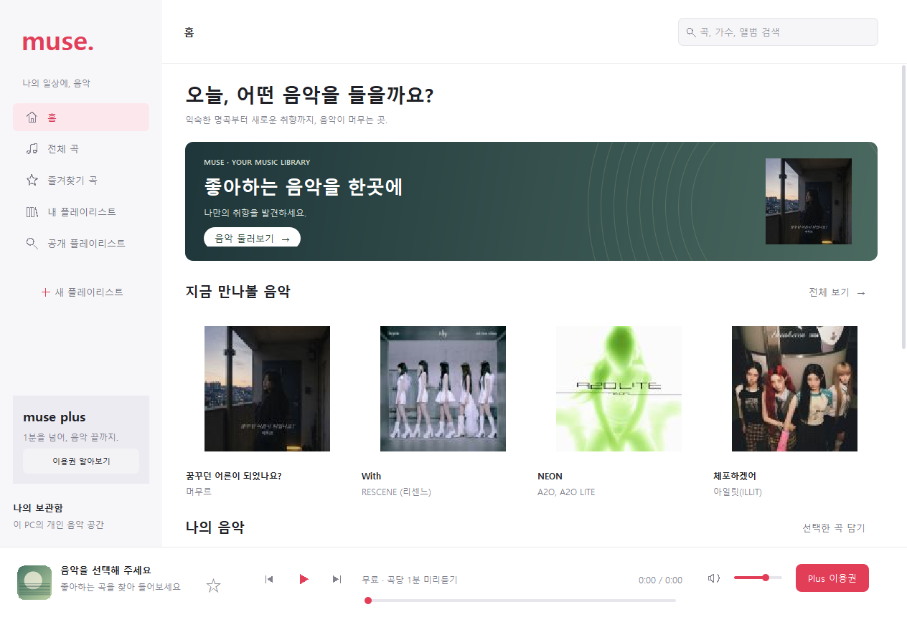

# muse · 음악 플레이리스트 공유 시스템

Java 17 · Swing · Oracle JDBC · 앨범 정보 · 별 즐겨찾기 · MP3 재생

[공개 저장소](https://github.com/yumin0117/JavaTermProject)



## 실행

이 PC에서는 `run.bat`을 실행하거나 IntelliJ IDEA 2025.3.3에서 `App.main()`을 실행한다.
**로그인 창 없이 바로 홈이 열린다.** 미리 설정한 Oracle DB에서 음악과 개인 목록을 불러온다.

다른 PC에서는 다음 순서로 준비한다.

1. `pom.xml`을 IntelliJ Maven 프로젝트로 열고 Project SDK와 Maven Runner JRE를 Java 17로 설정한다.
2. 완전히 빈 실습 스키마라면 `sql/01_original_schema_and_seed.sql`과 `COMMIT;`을 실행한다. 기존 테이블이 있다면 이 파일을 다시 실행하지 않는다.
3. `sql/02_add_sequence.sql` → `sql/06_music_and_membership.sql` → `sql/08_melon_chart.sql` → `sql/09_melon_snapshot.sql` → `sql/10_catalog_album_favorites.sql` → `sql/11_library_facts_snapshot.sql` 순서로 SQL Developer에서 F5로 실행한다.
4. `config/db.properties.example`을 `config/db.properties`로 복사하여 입력한다.
5. `App.main()`을 실행한다. Working directory는 이 `JavaTermProject` 폴더로 설정한다.

```properties
db.url=jdbc:oracle:thin:@localhost:1521:xe
db.username=c##dbsoft
db.password=실제_Oracle_비밀번호
```

SQL Developer 접속 이름 `c__dbsoft`와 실제 사용자명 `c##dbsoft`는 서로 다르다.
설정 파일은 UTF-8 Java properties 형식이며 실제 비밀번호 파일은 Git에 포함하지 않는다.
이 PC의 Java 17은 `%USERPROFILE%\.jdks\jdk-17.0.18+8`에 있다. Maven의 `package`를 실행하면 MP3와 드라이버가 포함된 `target/JavaTermProject-1.0.0.jar`가 생성된다.

```shell
mvn clean package
mvn -Poracle-test test
java -jar target/JavaTermProject-1.0.0.jar
```

## 구현 기능

- 홈·전체 곡·내 플레이리스트·공개 플레이리스트
- 제목/가수/앨범 검색, 즐겨찾기·음원 연결됨 필터
- 하단·홈·목록의 앨범 커버 클릭 → 발매일·앨범 유형·장르·발매사·기획사·선택 곡의 작사/작곡/편곡
- 하단 플레이어·목록·앨범 창의 별 저장/해제, 회원별 즐겨찾기 곡 조회
- 플레이리스트 생성·조회·제목/설명/공개 수정·삭제
- 실제 곡 담기·제거·위/아래 순서 교환, 공개 목록 좋아요·취소
- 실제 MP3 재생·일시정지·구간 이동·이전/다음·볼륨
- 무료 이용: 곡당 처음 60초까지 재생/이동, 끝나면 이용권 안내
- Plus 30일 이용권: 전체 재생, DB 결제 이력, 최근 결제 취소

**결제는 과제용 모의 결제이며 실제 돈은 청구하지 않는다.** 표시 가격은 4,900원이지만 실제 청구액은 0원이다. 카드번호나 결제 API 키를 받지 않는다. 유효한 이용권이 없으면 실제 오디오 출력 프레임을 60초로 제한한다.

## DB를 기준으로 동작하는 부분

곡 목록은 `MUSIC_CATALOG JOIN SONG LEFT JOIN SONG_MEDIA`, 소유 목록과 공개 목록은 `PLAYLIST`, 좋아요는 `PLAYLIST_LIKE`, 결제 상태는 `MEMBERSHIP_ORDER`에서 읽는다. 재생 시에도 서비스가 DB의 현재 시각과 유효기간을 조회한다. 결제 시 회원 행 잠금과 요청 UUID로 중복을 방지하고, 취소 시 기록을 남긴다. 로컬 파일에 결제 성공 여부나 플레이리스트 데이터를 대신 저장하지 않는다.

사용자가 요청한 대로 초기 로그인/회원가입 화면을 제거했다. 대신 `LocalProfileService`가 이 PC 전용 회원을 생성하고 PBKDF2 인증 후 사용한다. 기존 DEMO_HASH 계정을 로그인 우회에 사용하지 않는다. 개인 계정 식별자와 임의 인증 키는 `config/local-profile.properties`에만 보관하고 Git에서 제외한다. 이 파일을 없애면 새 보관함 계정이 만들어지므로 기존 개인 목록에 계속 접근하려면 보관한다. 비공개 접근·소유권 검사는 서비스와 SQL에서 유지된다.

기존 7개 테이블과 예시 30건은 유지한다. 첫 수집곡 100곡에 [멜론 최신곡](https://www.melon.com/new/index.htm) 50곡을 더해 **150곡**을 Oracle 음악 보관함에 저장했다. 화면에서는 요청대로 ‘멜론 TOP100’ 문구를 제거했다. 출처·수집 시점은 내부 자료에 보존한다.

`MUSIC_CATALOG`가 전체 보관함 곡을 관리하므로 차트에서 내려간 곡과 추가 수집곡도 사라지지 않는다. 추가 수집은 개발용 CatalogService에서 수행하며 앱 화면에는 가져오기 기능을 표시하지 않는다. 같은 곡은 기존 ID로 갱신하며 중복 행을 만들지 않는다. 곡 ID는 `1,000,000,000 + 멜론 곡 번호`, 가수 ID는 `2,000,000,000 + 멜론 가수 번호`로 유지한다.

앨범 정보는 `ALBUM_INFO`, 곡-앨범 연결은 `SONG_DETAIL`, 작사/작곡/편곡은 `SONG_CREDIT`의 역할별 행으로 저장한다. 150곡의 발매·크레딧 정보를 수집했으며 앨범은 141개다. 커버 클릭 시 먼저 DB 캐시를 읽고, 없으면 공개 곡/앨범 페이지에서 필요한 사실만 수집한다. 가사·상업 음원은 수집하지 않는다. 원문에 없는 정보는 ‘제공된 정보 없음’으로 표시한다. 수록곡 영역은 이 보관함에 저장된 곡만 표시한다.

별 즐겨찾기는 `SONG_FAVORITE(member_id,song_id)` 복합 기본키로 회원별 저장한다. 창을 닫거나 프로그램을 재실행해도 유지되며 다른 회원의 별 상태와 분리된다. 기존 플레이리스트 좋아요와 별 즐겨찾기는 별도 기능이다.

## 스타일과 음원 재생

Swing은 웹 CSS를 직접 적용하지 않으므로 FlatLaf의 선언식 스타일 파일 `src/main/resources/theme/muse.properties`를 적용했다. 색상·글꼴·버튼·표·입력란을 이 파일에서 수정한다. 차트 커버는 멜론이 제공한 URL에서 비동기로 표시하고, 연결 실패 시 앱 자체 그래픽을 쓴다.

**멜론 차트 정보 수집은 상업 음원 다운로드나 스트리밍 권한을 제공하지 않는다.** 보관함 곡은 음원 연결 전 ‘정보’ 상태로 표시한다. 곡을 더블클릭하면 멜론 곡 페이지를 열거나 해당 곡의 사용 권한이 있는 MP3를 연결할 수 있다. 연결한 파일은 `config/audio/`에 보관하고 공개 Git에서 제외한다. 곡·파일 연결과 확인한 길이는 DB에 저장하며, 연결 후 무료 60초/모의 Plus 전체 길이 재생이 적용된다. 모의 이용권에는 멜론 스트리밍 권한이 포함되지 않는다.

오디오 엔진 검증용으로 CC0 쇼팽 녹음 4개를 별도 유지했다. 기본 TOP100에는 포함하지 않는다. [음원 출처](docs/음원출처.md)와 `docs/audio-sources.json`에 원본·라이선스·해시가 기록되어 있다. 상업 곡 제목에 다른 녹음을 연결해 재생되는 것처럼 표시하지 않는다.

## 폴더 구조

```text
config/               외부 접속 정보 예시, 실제 설정·개인 인증 정보는 Git 제외
src/main/java/kr/ac/yumin/playlist/
  App.java            로그인 없이 메인 앱 실행
  config/             Oracle 설정과 연결
  model/              회원·곡·플레이리스트·음원·결제·이용권
  dao/                PreparedStatement와 조회/변경 SQL
  service/            권한·트랜잭션·모의 결제·재생 권한
  audio/              실제 MP3 디코딩/출력, 60초 제한 정책
  ui/                 메인·앨범·상세·목록 편집·이용권 화면
src/main/resources/
  theme/muse.properties
  audio/              CC0 실제 MP3 4개
src/test/java/        기본·실제 Oracle·오디오 검증 및 화면 캡처 도구
sql/                  원본 SQL, 실제 SQL Developer 내보내기, 추가 마이그레이션
docs/                 최종 PDF, 전체 소스, ER SVG, 캡처, 테스트 기록
tools/                DB 초기 추가 SQL 실행과 문서 재생성
```

## 제출 자료

- [보고서 PDF](docs/기말보고서_2601110285_김유민.pdf): 표지는 직접 작성하도록 항목 위치만 마련했다.
- `sql/04_sqldeveloper_export.sql`: 최초 7개 테이블/30건의 SQL Developer 내보내기 원본
- `sql/06_music_and_membership.sql`: 실제 곡/음원, 모의 결제 테이블 추가 SQL
- `sql/07_final_sqldeveloper_export.sql`: 이전 11개 테이블 내보내기 공유본
- `sql/08_melon_chart.sql`: 차트 스냅샷 테이블과 미확인 길이 NULL 허용
- `sql/09_melon_snapshot.sql`: 수집한 실제 TOP100 100곡 재현용 SQL
- `sql/10_catalog_album_favorites.sql`: 추가 테이블 5개 (총 16개)
- `sql/11_library_facts_snapshot.sql`: 150곡·141앨범·크레딧 1,116건 재현용 공개 정보 SQL
- `sql/12_final_schema_sqldeveloper_export.sql`: 최종 16개 테이블 SQL Developer DDL 내보내기
- [파일별 전체 코드](docs/전체소스코드.md), [테스트 순서](docs/테스트순서.md), [검증 결과](docs/검증결과.md)

SQL Developer 내보내기 07은 실제 마법사에서 생성한 파일의 공유본이다. 개인 보관함 회원은 예시 3명만 내보내도록 필터링했고, 개인 결제 INSERT 1줄은 공유본에서 제외했다. 로컬 스키마명·저장영역 설정과 DDL 구분자 형식이 포함되므로 다른 PC의 빈 스키마에는 원본 생성 SQL + 02 + 06 + 08 + 09 + 10 + 11 순서로 실행한다. 기존 DB에서 생성/복원 SQL을 중복 실행하지 않는다. 생성 방식과 검증한 행 수·해시는 `docs/sql-export-metadata.json`에 기록했다.

## 검증

Java 17 빌드와 테스트 17개가 실제 Oracle에서 통과했다. 기본 사운드 장치를 음량 0으로 열어 무료 60초 정지, 유료 61초 이후 재생, 일시정지·재개도 확인했다. 주요 화면 14개는 실제 DB에 새로 만든 임시 계정으로 캡처한 뒤 해당 임시 데이터만 정리했다. `ui.DesignCapture`는 디자인 QA 도구이며 운영 앱은 그 픽스처 데이터를 사용하지 않는다.

시퀀스 번호와 신규 개인 계정은 정상적으로 증가한다. 시퀀스의 번호 공백은 롤백 시에도 발생할 수 있으며 오류가 아니다. 저장소의 DB 비밀번호·개인 인증 정보 제외 여부를 검증했다.

최종 DDL 내보내기 12는 개인 회원·결제·즐겨찾기 데이터를 포함하지 않는다. 공개 음악 사실의 재현은 11을 사용한다. SQL Developer 내보내기 원문은 환경별 스키마·저장영역·구분자를 포함하므로 실행용 순서는 위 추가 SQL 안내를 따른다.

화면 정리: 좋아요한 목록 메뉴, 곡 가져오기 버튼, 연결 설정 화면, 홈의 보관함 곡 수 문구를 제거했다. 별 즐겨찾기와 공개 플레이리스트의 좋아요 동작은 유지한다.
