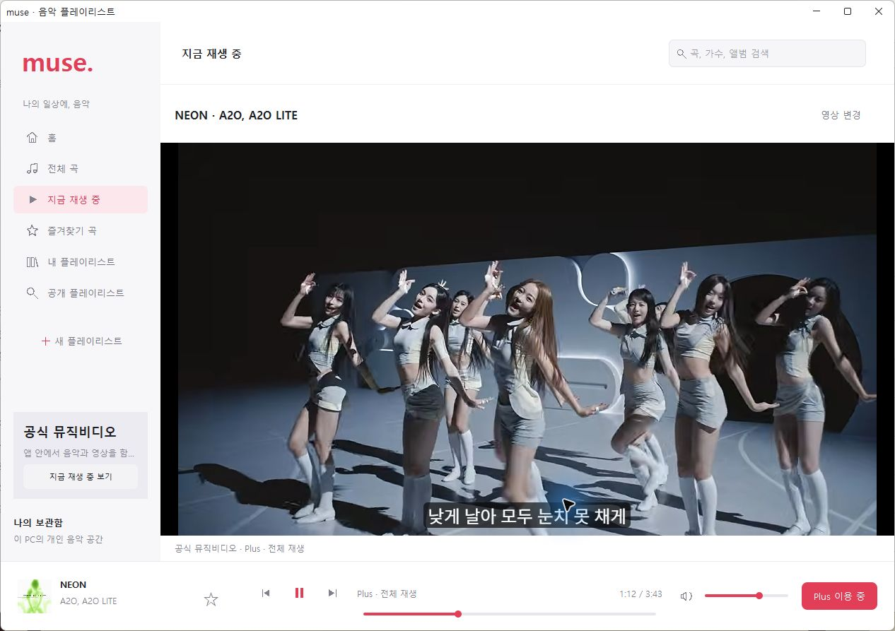

# muse · 음악 플레이리스트 공유 시스템

Java 17 · Swing · Oracle JDBC · 앱 안에서 재생하는 공식 영상 · 앨범 정보 · 별 즐겨찾기

[공개 저장소](https://github.com/yumin0117/JavaTermProject)



## 실행

이 PC에서는 `run.bat`을 실행한다. IntelliJ IDEA 2025.3.3에서는 `pom.xml`을 Maven 프로젝트로 열고 SDK 17, 작업 디렉터리 `JavaTermProject`, 실행 클래스 `kr.ac.yumin.playlist.App`을 지정한다. 로그인 없이 개인 보관함이 열린다.

다른 PC의 완전히 빈 실습 스키마에서는 SQL Developer F5로 다음 순서로 실행한다.

`01` → `COMMIT;` → `02` → `06` → `08` → `09` → `10` → `11` → `13` → `14`

기존 테이블이 있는 스키마에서 원본 01을 다시 실행하지 않는다. 추가 SQL은 기존 자료를 유지한다. 14 재실행은 이미 선택한 영상 연결을 덮어쓰지 않는다.

`config/db.properties.example`을 `config/db.properties`로 복사하여 Oracle 접속 정보를 입력한다. SQL Developer 접속 이름 `c__dbsoft`와 실제 사용자명 `c##dbsoft`는 다르다. 실제 비밀번호·개인 인증 정보·브라우저 캐시·사용자 MP3는 Git에서 제외한다.

```shell
mvn -Poracle-test package
java -jar target/JavaTermProject-1.0.0.jar
```

온라인 영상은 인터넷 연결이 필요하다. 첫 영상 실행 시 JCEF가 Chromium 구성 요소를 `.runtime/jcef`에 내려받으므로 잠시 걸릴 수 있다. 이 PC에는 설치가 완료되어 있다.

## 재생과 모의 등급

- 곡의 **영상** 버튼·더블클릭·홈 재생 버튼을 누르면 앱 중앙이 뮤비 플레이어로 바뀐다. 왼쪽 메뉴와 하단 플레이어는 유지된다.
- 새 재생 창, 외부 브라우저, MP3 연결 안내창을 띄우지 않는다. YouTube 표준 임베드를 사용하여 오른쪽 추천 목록·댓글·구독 영역이 없다.
- 무료 등급은 영상의 60초 지점에서 멈추고 60초 이후 재생을 제한한다. 사용자가 끄는 체크박스는 없다.
- Plus 모의 결제가 Oracle에 저장되면 전체 길이를 재생한다. 최근 모의 결제를 취소하면 무료 제한을 다시 적용한다. 만료 시에도 무료 제한으로 전환한다.
- 결제 표시는 4,900원/30일이지만 **실제 청구액은 0원**이다. 카드번호·결제사 API·실제 결제를 사용하지 않는다.
- 표준 영상 컨트롤·YouTube 표시·광고를 유지한다. 영상 파일이나 MP3, 미디어 스트림 URL을 추출하거나 저장하지 않는다.
- 다른 메뉴로 이동하면 온라인 영상은 일시정지한다. 이전/다음·위치 이동·음량·하단 재생 버튼을 실제 플레이어와 연결했다.

## 곡과 데이터베이스

실제 보관함 150곡, 앨범 141건, 곡-앨범 150건, 작사/작곡/편곡 크레딧 1,116건을 Oracle에 저장했다. 최초 차트 100곡과 추가 최신곡 50곡은 MUSIC_CATALOG를 기준으로 유지한다. 화면에서 TOP100 문구·곡 가져오기·연결 설정·좋아요한 목록 메뉴를 제거했다.

2026-11-26 확인 기준으로 공식 영상 메타데이터 137곡을 연결했고 **119곡은 실제 앱의 임베드 재생을 확인했다.** 13곡은 공식 전체 영상을 확인하지 못했으며, 연결된 18곡은 임베드 제한/재생 미확인 상태다. 이 곡들은 `미연결` 또는 `재생 제한`으로 표시한다. 확인하지 못한 곡을 다른 곡·팬 영상·티저로 바꾸지 않는다. 공식 MV가 없는 경우 공식 음원 영상·공식 공연 영상을 구분하여 연결했다. [전체 연결 및 확인 상태](docs/youtube-links.json)

`SONG_VIDEO`가 곡별 영상 ID·제목·채널·종류·검색어·확인 상태·확인 시각을 보관한다. 재생할 때 Oracle에서 곡과 현재 이용권을 조회한다. 브라우저 파일에 유료 여부를 저장하지 않는다. `PLAYABLE`은 해당 시점의 검증 기록이며 게시자·지역·삭제 정책에 따라 이후 재생 가능 여부가 달라질 수 있다. 앱의 `영상 변경`으로 다른 공식 주소를 연결할 수 있다.

## 구현 기능

- 제목·가수·앨범 검색, 전체 곡·즐겨찾기 곡·내 목록·공개 목록
- 커버 클릭 → 발매일·유형·장르·발매사·기획사·선택 곡의 작사/작곡/편곡
- 하단·목록·앨범 창의 별 저장/해제, 회원별 DB 저장 및 재실행 후 유지
- 플레이리스트 생성·조회·수정·삭제, 곡 담기·제거·순서 변경, 공개 목록 좋아요·취소
- 로그인 화면 없이 PC 전용 개인 회원을 생성·재사용하고 PBKDF2 인증과 소유권 검사는 유지
- 모의 결제 UUID 중복 방지·회원 행 잠금·DB 시각으로 만료 확인·취소 이력 유지

기존 7개 테이블과 원본 예시 30건을 유지하고 총 17개 테이블로 확장했다. 앨범 정보는 ALBUM_INFO/SONG_DETAIL/SONG_CREDIT, 별은 SONG_FAVORITE, 개인 목록은 PLAYLIST/PLAYLIST_SONG, 모의 결제는 MEMBERSHIP_ORDER에서 읽는다. 연결 테이블과 외래키·복합 기본키·트랜잭션·PreparedStatement를 사용한다.

Swing 스타일은 `src/main/resources/theme/muse.properties`(FlatLaf)에서 관리한다. 예전 MP3 엔진과 권한 정책은 검증용 CC0 쇼팽 4곡으로 유지하며 기본 150곡에는 섞지 않는다. [음원 출처](docs/음원출처.md)

## 제출 자료와 검증

- `docs/기말보고서_2601110285_김유민.pdf`: 표지는 사용자가 직접 채우도록 항목 위치만 배치
- `docs/design/er-final.svg`: 최종 17개 테이블 E-R 설계
- `sql/15_video_schema_sqldeveloper_export.sql`: SQL Developer 내보내기 마법사로 생성한 현재 17개 테이블 DDL 원문
- `sql/11_library_facts_snapshot.sql`, `sql/14_youtube_links.sql`: 공개 음악 정보·영상 연결 재현 SQL
- `docs/전체소스코드.md`, `docs/검증결과.md`, `docs/테스트순서.md`

Java 17 + 실제 Oracle 테스트 20개가 통과했다. 별도 실제 플레이어 검증에서 무료 60.09초 정지, 무료 이어듣기 차단, Oracle 모의 구매 후 62초 이후 재생, 취소 후 제한 복귀를 확인했다. 테스트는 임시 회원의 데이터만 정리한다.

공식 구현 문서: [JCEF Maven](https://github.com/jcefmaven/jcefmaven), [YouTube IFrame API](https://developers.google.com/youtube/iframe_api_reference), [플레이어 파라미터](https://developers.google.com/youtube/player_parameters).
